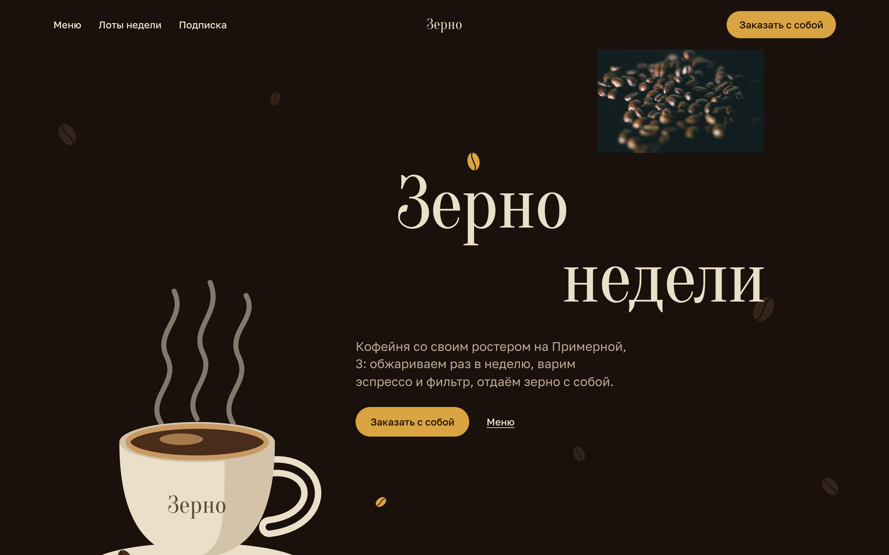
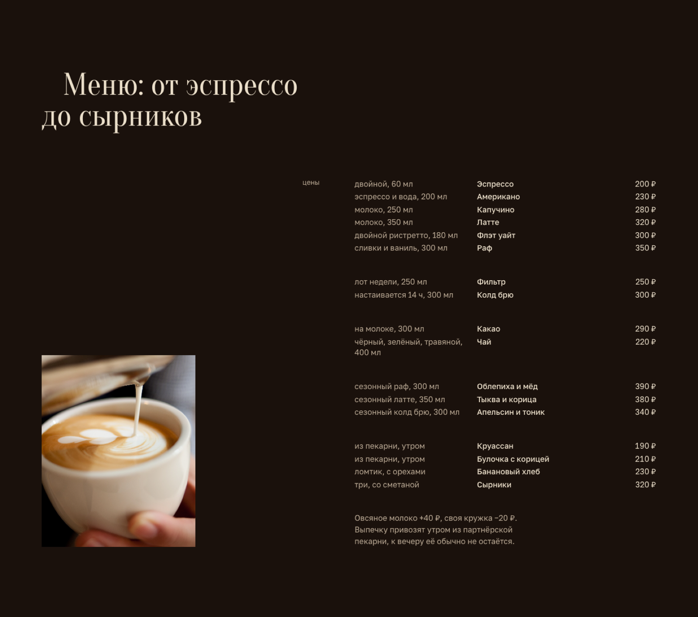
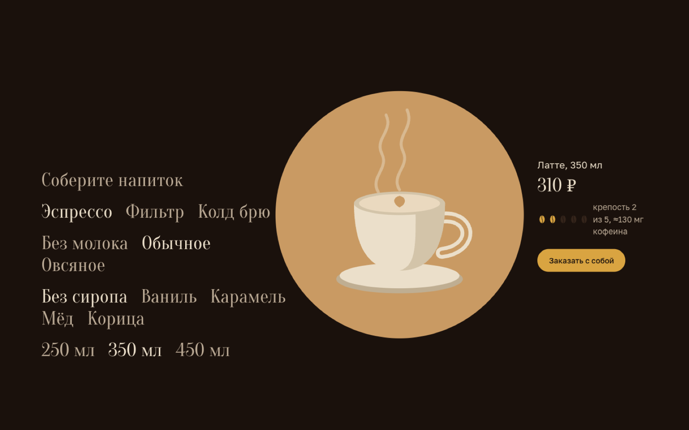
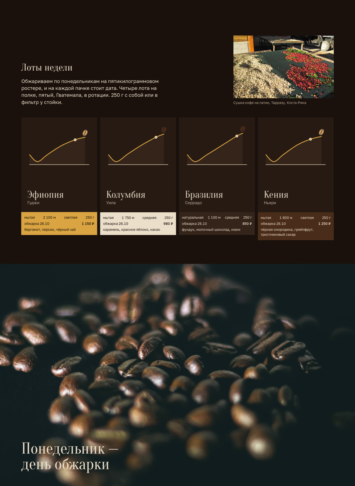
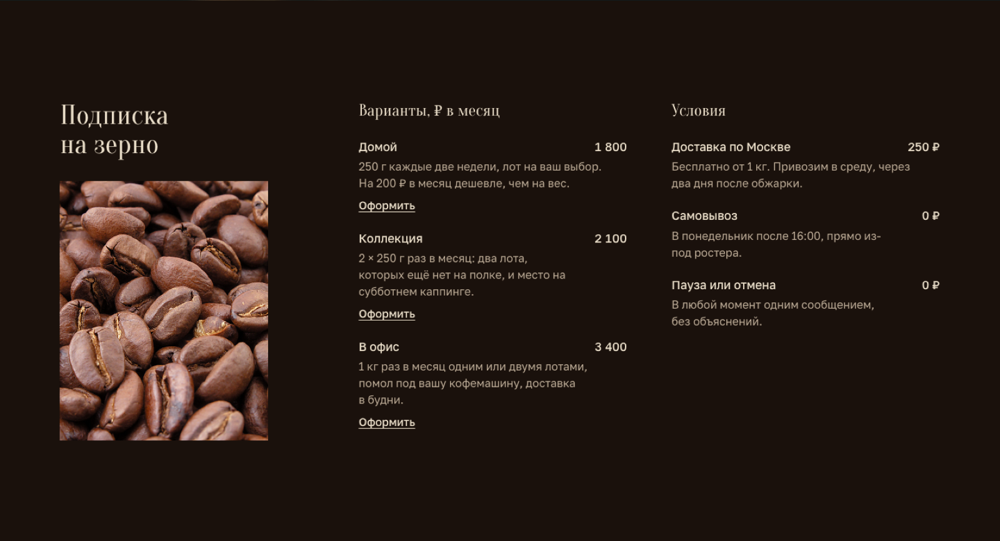
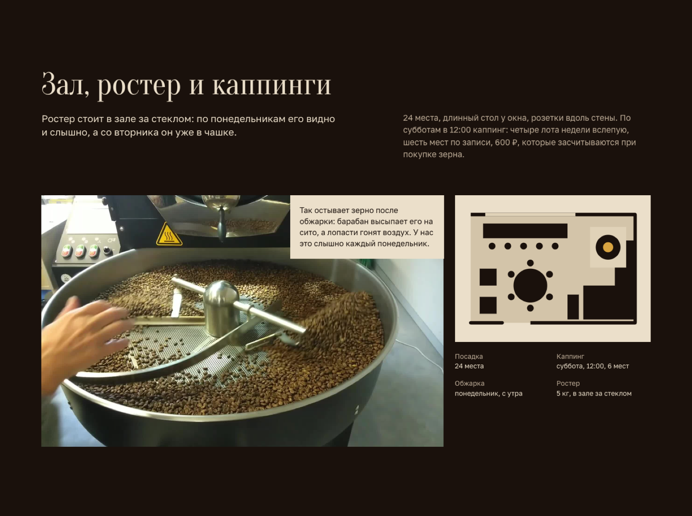
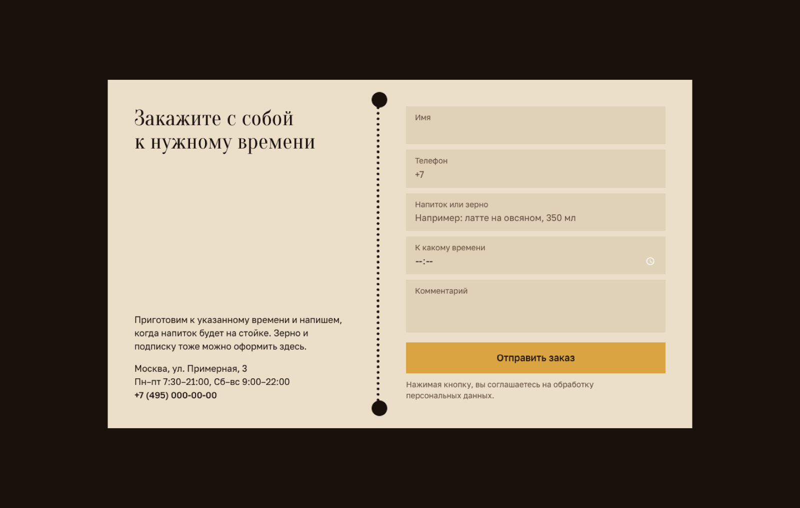
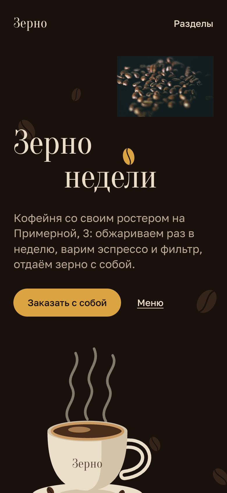

# Зерно — сайт кофейни со своим ростером

Одностраничный сайт кофейни в Москве: меню с ценами, конструктор напитка, лоты зерна недели, подписка на зерно, каппинги и форма предзаказа. Демо для портфолио: компания вымышленная, цены и имена — примеры.

**Демо:** https://malishq.github.io/coffee-shop-website/

## Что умеет

- Главный экран с подписной анимацией: заголовок собирается по буквам (GSAP SplitText), над нарисованной чашкой медленно поднимается пар (DrawSVG + бесконечный цикл), зёрна и чашка плавно смещаются при скролле (параллакс).
- Полное меню с ценами: 17 позиций в пяти группах (эспрессо-напитки, фильтр и колд брю, без кофе, три сезонных напитка, выпечка).
- «Соберите напиток»: основа → молоко → сироп или добавка → объём. Считает цену, примерную крепость (в зёрнах, 1–5) и кофеин в миллиграммах, рисует выбранный напиток (чашка, V60 или кемекс, стакан колд брю) на диске, цвет которого зависит от молока. Работает с клавиатуры (это обычные радиокнопки) и на телефоне; без JavaScript показываются строки выбора и напиток по умолчанию.
- Кнопка «Заказать с собой» подставляет собранный напиток в форму предзаказа и прокручивает к ней.
- Лоты недели: четыре плитки-бирки с профилем обжарки, обработкой, высотой, нотами, датой обжарки и ценой за 250 г.
- Подписка на зерно: три варианта с ценами и условия доставки; ссылка «Оформить» тоже заполняет форму.
- Зал и каппинги: клип остывания зерна в ростере (играет только в поле зрения и не играет при `prefers-reduced-motion`), план зала, факты.
- Вопросы и ответы на `<details>` — открываются без скриптов.
- Форма предзаказа в виде купона: имя, телефон, напиток или зерно, время готовности, комментарий; валидация и экран успеха. Работает без сервера, по желанию шлёт JSON на `NEXT_PUBLIC_FORM_ENDPOINT`.
- Плавный скролл Lenis, ревилы секций на GSAP ScrollTrigger, учёт `prefers-reduced-motion`.
- Мобильная версия со своей композицией: фото над заголовком, строки конструктора переносятся, купон разворачивается вертикально.

## Стек

Next.js 16 (статический экспорт), React 19, Tailwind CSS 4, GSAP 3.15 (ScrollTrigger, SplitText, DrawSVG), Lenis. Шрифты Oranienbaum и Golos Text через `next/font/google` с кириллицей. Все иллюстрации — инлайновые SVG в палитре сайта.

## Скриншоты

















## Запуск

```bash
npm ci
npm run dev
```

Сборка: `npm run build` (папка `out/`). Выкладка на GitHub Pages: `scripts/deploy.sh` (собирает с `NEXT_PUBLIC_BASE_PATH=/coffee-shop-website` и пушит ветку `gh-pages`).

## Как адаптировать под клиента

- Название, адрес, телефон, часы, день обжарки, навигация — `src/lib/site.ts`.
- Меню и цены, лоты недели (страна, регион, обработка, высота, ноты, цена, форма кривой обжарки), варианты подписки, условия, вопросы и ответы — `src/lib/menu.ts`.
- Цены и логика конструктора (основы, молоко, сиропы, объёмы, кофеин) — `src/components/DrinkBuilder.tsx`.
- Тексты секций — `src/components/Hero.tsx`, `Lots.tsx`, `Space.tsx`, `ContactForm.tsx`.
- Цвета и типографика — `src/app/globals.css`, шрифты — `src/app/layout.tsx`.
- Приём заявок: укажите адрес приёма в `NEXT_PUBLIC_FORM_ENDPOINT` (POST JSON с полями `name`, `phone`, `item`, `time`, `comment`).

Все цены, лоты, условия подписки и факты о зале — примерные данные, их нужно заменить на реальные.

## Источники картинок

Фотографии и видео скачаны с Wikimedia Commons и лежат в `public/images`; авторы и лицензии указаны также в подвале сайта.

| Файл | Название | Автор | Лицензия |
| --- | --- | --- | --- |
| `beans-dark.jpg` | [Roasted coffee beans on the surface. 01](https://commons.wikimedia.org/wiki/File:Roasted_coffee_beans_on_the_surface._01.jpg) | A S M Jobaer | [CC BY-SA 4.0](https://creativecommons.org/licenses/by-sa/4.0/) |
| `latte-pour.jpg` | [Latte art 3](https://commons.wikimedia.org/wiki/File:Latte_art_3.jpg) | Kim Sanso | [CC0](https://creativecommons.org/publicdomain/zero/1.0/) |
| `beans-roasted.jpg` | [Roasted coffee beans](https://commons.wikimedia.org/wiki/File:Roasted_coffee_beans.jpg) | MarkSweep | [общественное достояние](https://creativecommons.org/publicdomain/mark/1.0/) |
| `cherries-tarrazu.jpg` | [Coffee cherries, Tarrazú](https://commons.wikimedia.org/wiki/File:Coffee-cherries-green-coffee-tarrazu-costa-rica.jpg) | Tarrazu | [общественное достояние](https://creativecommons.org/publicdomain/mark/1.0/) |
| `roaster-cooling.webm`, `roaster-cooling-poster.jpg` | [Kaffe – Ystad 2024](https://commons.wikimedia.org/wiki/File:Kaffe_-_Ystad-2024.ogg) | Jonn Leffmann | [CC BY 3.0](https://creativecommons.org/licenses/by/3.0/) |

Чашка с паром, напитки конструктора, зёрна, профили обжарки и план зала нарисованы кодом (`src/components/drawings.tsx`).
